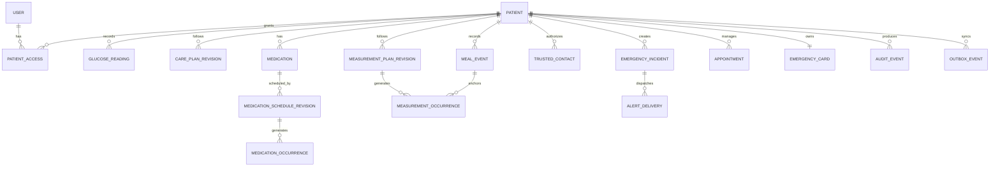

# Domain data model

## Modeling rules

- Store timestamps as UTC instants plus original timezone and offset when the local meaning matters.
- Use UUIDs generated on-device.
- Use integer or fixed-decimal representations for clinical values; never binary floating point for equality or boundary decisions.
- Keep original glucose value/unit and a canonical normalized value.
- Prefer append-only clinical events and versioned plans over in-place mutation.
- Every synchronized record includes `patient_id`, `created_at`, `updated_at`, `version`, and optional `deleted_at`.

## Entity overview



## Core entities

### Patient

| Field | Type | Notes |
|---|---|---|
| `id` | UUID | Local generation permitted. |
| `display_name` | text | Preferred name. |
| `birth_date` | date nullable | Collect only if needed. |
| `locale` | BCP-47 tag | Example: `es-CO`. |
| `timezone` | IANA zone | Example: `America/Bogota`. |
| `glucose_unit` | enum | `mg_dl`, `mmol_l`. |
| `simple_mode` | boolean | Accessibility preference. |
| `cloud_sync_enabled` | boolean | Explicit opt-in. |

### Patient access

Relationship-based authorization for `owner`, `caregiver`, `clinician`, or `support_admin`. MVP exposes only owner access; trusted alert recipients are not automatically granted record access.

### Glucose reading

| Field | Type | Notes |
|---|---|---|
| `id` | UUID | Idempotency anchor. |
| `patient_id` | UUID | Owner. |
| `value_original` | integer/fixed decimal | Exact entered/imported value. |
| `unit_original` | enum | Never inferred. |
| `value_mg_dl` | integer | Canonical comparison value. |
| `conversion_version` | text | Required for converted values. |
| `measured_at` | timestamptz | User-meaningful time. |
| `timezone` / `utc_offset_minutes` | text/int | Original local context. |
| `recorded_at` | timestamptz | Creation time. |
| `time_edited` | boolean | Indicates manual correction. |
| `context` | enum | fasting/pre/post meal, bedtime, exercise, illness, symptoms, or other. |
| `meal_offset_minutes` | int nullable | For post-meal interpretation. |
| `source` | enum | manual/import/cgm/glucometer. |
| `symptoms` | text[]/join table | Controlled vocabulary + other. |
| `ketone_result` | enum nullable | User-entered strip result; not interpreted by the app. |
| `care_plan_revision_id` | UUID nullable | Rule set used. |
| `classification` / `rule_id` | enum/text | Explainable result; the mobile projection stores these as `risk_classification` and `risk_rule_id`. |
| `risk_plan_updated_at` | timestamptz nullable | Care-plan revision timestamp used for the classification; retained with the reading for historical auditability. |

Edits create an audit event containing before/after values; deletion uses tombstone plus retention policy.

### Care plan revision

Immutable revision with effective period, target bands, urgent rules, symptom actions, ketone instructions, author/source, reviewed date, content locale, and clinician-verification flag.

Only one revision is active for a patient at a given instant. Historical readings retain their evaluated revision.

### Medication and schedule

`medication` stores prescribed information (presentation, dose text, route, prescriber, instructions, and optional validity dates). Its local `schedule_json` stores the user-entered schedule metadata: fixed times, an interval anchored to a local time, or an offset from an explicitly recorded meal, with optional weekday filters. The local runtime does not create occurrences or repeating notifications outside the medication validity window; this is a reminder boundary, not a dose decision. Generated `medication_occurrence` records one expected action with a deterministic key:

`schedule_revision_id + scheduled_instant`

Occurrence statuses:

`planned | due | taken | skipped | snoozed | expired | not_recorded`

Future doses remain `planned` until their scheduled instant. Only `due` or
`snoozed` occurrences can be acknowledged by the patient; a planned dose
cannot be marked taken early.

“Reminder opened” is telemetry, not adherence.

### Measurement plan and occurrence

The current mobile slice supports fixed local times, explicit meal-relative windows, weekday exceptions, temporary validity dates, and a clinician/user-provided context per reading. A relative window is resolved only from an explicitly recorded `meal_event`; the app never infers meal times or guesses a missing context.

Occurrence statuses:

`planned | due | completed | skipped | expired`

Measurement windows remain `planned` until their scheduled instant. A reading
or skip can only complete a `due` window; future windows cannot be acknowledged
early.

### Meal event

An explicit patient-entered meal timestamp (`breakfast`, `lunch`, `dinner`, or `snack`) with an optional note. Meal events are only anchors for relative measurement windows; they never imply nutrition, dosing, or a clinical interpretation.

### Trusted contact

| Field | Notes |
|---|---|
| Name and relationship | Patient-provided. |
| Email/phone | Verified per enabled channel. |
| Consent status | invited/accepted/revoked/expired. |
| Allowed event types | Emergency, urgent reading, missed check-in; separate toggles. |
| Allowed fields | Default minimum: patient preferred name, event type, timestamp, callback action. |
| Quiet hours | Never suppress explicit emergency alert; disclose behavior. |
| Last consent change | Audited. |

### Emergency incident

Append-only event with patient/device timestamps, trigger (`manual`, `risk_rule`), selected symptoms, optional reading reference, location availability/freshness, call attempt, contact-alert request, resolution note, and close time.

### Alert delivery

One row per incident/contact/channel/attempt:

`queued | provider_accepted | delivered | failed | unknown | acknowledged`

Acknowledgement is a separate authenticated or signed-link action; it is never inferred from provider acceptance.

### Appointment

| Field | Notes |
|---|---|
| `status` | State machine below. |
| `specialty`, `provider_name` | Free text in MVP. |
| `insurer`, `facility` | EPS/IPS details. |
| `authorization_number` | Sensitive; encrypted/synced only with consent. |
| `requested_at`, `authorized_at`, `scheduled_at` | Nullable by state. |
| `location`, `virtual_url` | Optional. |
| `preparation_notes` | User/provider text. |
| `reminder_policy` | Versioned schedule. |

Allowed transitions:

```text
requested -> pending_authorization | authorized | cancelled
pending_authorization -> authorized | denied | cancelled
authorized -> scheduled | cancelled
scheduled -> completed | missed | cancelled
denied -> requested
```

### Emergency card

The local emergency card includes diabetes history, allergies/critical conditions, insurer/affiliation data, the patient's preferred care facility, and an optional verified emergency number and region. If the number fields are empty, the build's reviewed launch fallback is shown explicitly; the app never claims that the fallback is correct for every municipality.

One current card plus revision history. Fields are described in the PRD. The on-device projection must be readable offline without querying the cloud.

### Audit event

Append-only record of actor, action, entity, entity ID, timestamp, device/session, reason when required, and structured before/after diff. Never store secrets or full notification payloads in audit logs.

### Outbox event

| Field | Notes |
|---|---|
| `id` | Idempotency key. |
| `aggregate_type/id` | Target record. |
| `event_type`, `schema_version` | Versioned contract. |
| `payload_encrypted` | Minimum data needed for sync. |
| `attempt_count`, `next_attempt_at` | Bounded backoff. |
| `status` | pending/sending/acked/failed/dead_letter. |

## Index plan

- `(patient_id, measured_at desc)` on glucose readings.
- `(patient_id, status, scheduled_at)` on occurrences and appointments.
- `(patient_id, active_from, active_to)` on plan revisions.
- `(status, next_attempt_at)` on outbox.
- Unique deterministic occurrence key.
- Unique alert idempotency key per contact/channel/event.

## Retention and deletion

Retention is a policy decision, not a database default. The implementation must support:

- User export before deletion.
- Local-only deletion and account-wide deletion.
- Tombstone propagation to synced devices.
- Defined backup expiry.
- Legally required holds, if any, separately documented and disclosed.
- Aggregated analytics that cannot reasonably be linked back to the patient.
